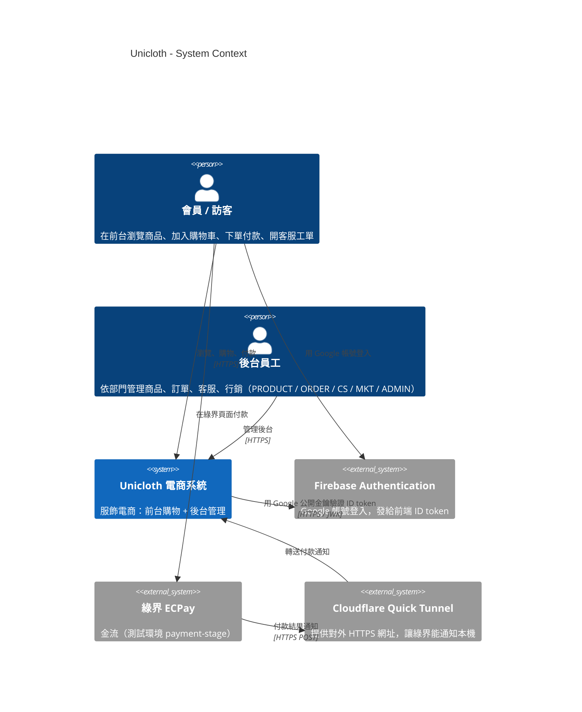
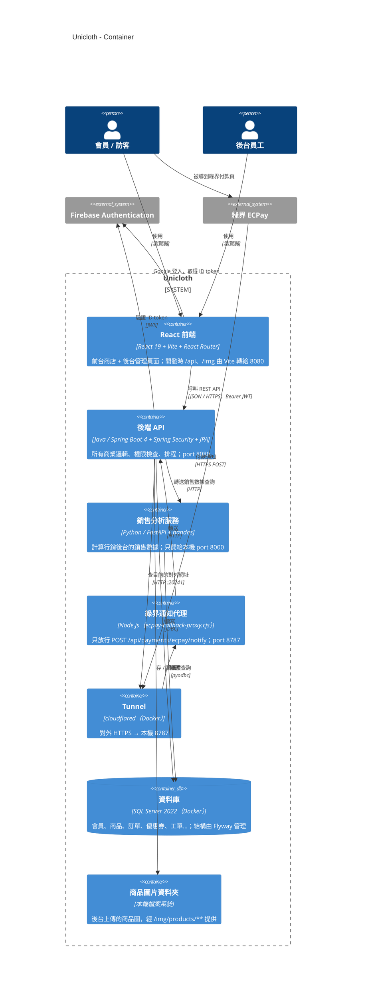
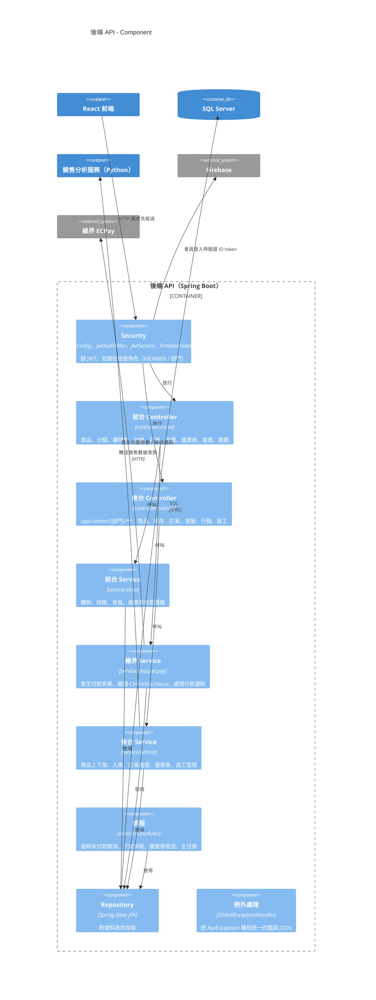
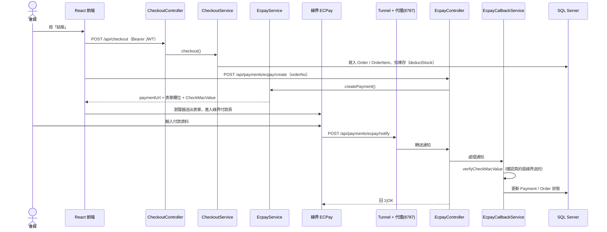

# Unicloth 架構圖（C4 Model）

C4 Model 用「由遠到近」四層圖說明系統，像 Google 地圖一樣逐步放大：

| 層級 | 回答的問題 |
| --- | --- |
| 1. System Context（系統情境） | 誰在用 Unicloth？它跟哪些外部系統往來？ |
| 2. Container（容器） | Unicloth 由哪幾個「可以單獨啟動」的程式組成？ |
| 3. Component（元件） | Spring Boot 後端裡面分成哪些區塊？ |
| 4. Code（程式碼） | 類別之間的關係（這份文件只舉一個例子，其餘直接看程式碼） |

> 這裡的「Container」是 C4 的用語，意思是「一個可以單獨執行的程式或資料庫」，**不是**專指 Docker container。
> 圖用 Mermaid 畫，GitHub 和 IntelliJ（裝 Mermaid 外掛）都能直接顯示。

---

## 1. System Context（系統情境）

**重點：**

- 會員登入不是自己存密碼，而是交給 **Firebase（Google 登入）**；後端只負責驗證 Firebase 給的 token，再發自己的 JWT。
- 員工登入走另一條路：帳號密碼存在自己的資料庫（`staff` 表）。
- 綠界的伺服器連不到 `localhost`，所以要靠 **Cloudflare Tunnel** 開一個對外網址，付款通知才進得來（詳見 [README-ECPAY.md](../README-ECPAY.md)）。

---

## 2. Container（容器）

**各容器怎麼啟動：**

| 容器 | 啟動方式 |
| --- | --- |
| 資料庫、Tunnel、銷售分析服務 | `docker compose up -d`（見 `docker-compose.yml`） |
| 後端 API | `./mvnw spring-boot:run` 或 IDEA 按 Run |
| 綠界通知代理 | `node ecpay-callback-proxy.cjs` |
| React 前端 | `frontend/` 裡 `npm run dev` |

**為什麼銷售數據不讓前端直接連 Python？**
Python 服務自己不檢查登入，所以只開給本機；前端一律先打 Spring Boot（`/api/admin/mkt/sales/**`），由 Spring Security 確認是 MKT 或 ADMIN 部門，再由 `AdminSalesService` 轉給 Python。

---

## 3. Component（元件）— 後端 API 內部

Spring Boot 採用分層架構：**Controller → Service → Repository → Entity**，一層只呼叫下一層。

### 後台權限（只看部門）

| API 路徑 | 可進入的部門 |
| --- | --- |
| `/api/admin/product/**` | PRODUCT、ADMIN |
| `/api/admin/order/**` | ORDER、ADMIN |
| `/api/admin/cs/**` | CS、ADMIN |
| `/api/admin/mkt/**` | MKT、ADMIN |
| `/api/admin/admin/**` | ADMIN |

一個員工只屬於一個部門，規則寫在 `SecurityConfig`，部門定義在 `enums/staff/Department.java`。

### 排程（`service/scheduler`）

| 類別 | 做什麼 | 頻率 |
| --- | --- | --- |
| `OrderTimeoutScheduler` | 逾時未付款的訂單自動取消 | 每 10 分鐘 |
| `ProductOffShelfScheduler` | 到了下架時間的商品自動下架 | 依設定 |
| `CouponSendScheduler` | 到了發送時間的優惠券發給會員 | 每 1 分鐘 |
| `BirthdayCouponScheduler` | 發生日券 | 每天 0 點、12 點 |

---

## 4. Code（程式碼）— 舉例：下單付款流程

第 4 層通常不畫完整，只挑重要流程看。以下是「結帳 → 綠界付款 → 付款通知」的順序：

> 庫存是在**建立訂單時**就扣（`CheckoutService` 呼叫 `deductStock`），不是付款後才扣；逾時沒付款的訂單會被 `OrderTimeoutScheduler` 取消。

---

## 相關文件

- [db-tables.md](db-tables.md)：資料表
- [auth-plan.md](auth-plan.md)：登入與權限
- [admin-pages.md](admin-pages.md)：後台頁面
- [sales-data-plan.md](sales-data-plan.md)：銷售數據
- [api/](api/)：各 API 規格
