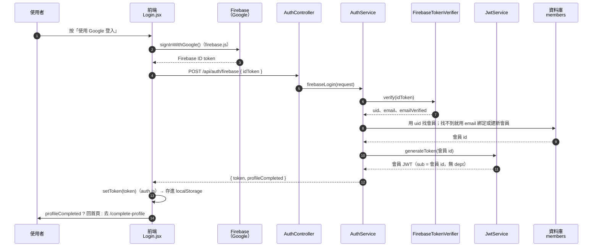
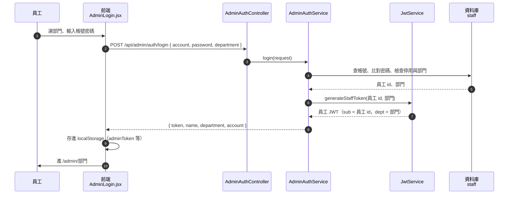
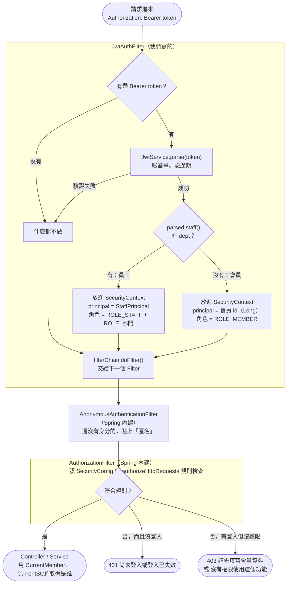
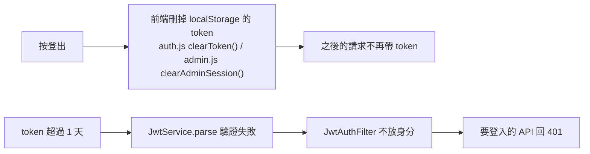

# JWT 流程

專案裡有兩種 JWT：**會員 token**（前台）和**員工 token**（後台）。兩種都由後端 `JwtService` 簽發，用同一把金鑰簽章。

| | 會員 token | 員工 token |
|---|---|---|
| 怎麼拿到 | Google 登入（Firebase）後換 | 後台帳號密碼登入 |
| `sub` | 會員 id | 員工 id |
| 額外 claim | 無 | `dept`（部門，例如 `PRODUCT`） |
| 前端存放位置 | `localStorage` 的 `token` | `localStorage` 的 `adminToken` |
| 拿到的角色 | `ROLE_MEMBER` | `ROLE_STAFF` + `ROLE_部門` |

判斷方式：**有 `dept` 就是員工 token，沒有就是會員 token**。

---

## 1. 會員登入：拿到會員 token



## 2. 員工登入：拿到員工 token



> ADMIN（管理者）選哪個部門都能登入，但 token 裡的 `dept` 一律是 `ADMIN`，保留所有部門的權限。

## 3. 之後每個請求：驗證 token、檢查權限

前端每次呼叫 API 時自動帶上 `Authorization: Bearer <token>`：
- 前台用 `api.js` 的 `api()`，帶會員 token
- 後台用 `admin.js` 的 `adminApi()`，帶員工 token

後端收到請求後，會依序經過 Spring Security 的過濾鏈。以下是跟 JWT 有關的幾關：



重點：
- `JwtAuthFilter` **只負責辨識身分，從不擋人**。token 無效也照樣往下傳，交給後面的 `AuthorizationFilter` 決定要不要擋，所以看商品這類不用登入的 API 才能正常放行。
- `JwtAuthFilter` 不加 `@Component`，而是在 `SecurityConfig` 裡用 `addFilterBefore(new JwtAuthFilter(jwtService), UsernamePasswordAuthenticationFilter.class)` 掛進過濾鏈。加了 `@Component` 的話，同一個請求會被多跑一次。
- 401 / 403 回應的內容，寫在 `SecurityConfig` 的 `unauthorizedEntryPoint()` 和 `accessDeniedHandler()`。

### `SecurityConfig` 的主要規則

規則由上往下比對，第一條符合的生效：

| 路徑 | 規則 |
|---|---|
| `POST /api/auth/firebase`、`/api/auth/logout`、`/api/admin/auth/login` | 不用登入 |
| `GET /api/products/**`、`/api/categories/**`、`/api/styles/**`、`/api/recommendations/**` | 不用登入 |
| `POST /api/payments/ecpay/notify` | 不用登入（綠界通知） |
| `/api/admin/部門/**` | 該部門或 ADMIN 的員工 token |
| `/api/admin/**`（其他） | 任何員工 token（`ROLE_STAFF`） |
| `GET /api/member/me`、`PUT /api/member/me/complete-profile` | 會員 token（`ROLE_MEMBER`） |
| 其他 `/api/**` | 會員 token，**而且補填過個人資料** |
| `/api` 以外（圖片、Swagger…） | 不用登入 |

### 實際的過濾鏈順序

以下是用 `FilterChainProxy` 實際印出來的順序（2026-11-03 確認），請求由上往下經過：

```
DisableEncodeUrlFilter
WebAsyncManagerIntegrationFilter
SecurityContextHolderFilter
HeaderWriterFilter
LogoutFilter
JwtAuthFilter                  ← 我們的：驗 token、放身分
RequestCacheAwareFilter
SecurityContextHolderAwareRequestFilter
AnonymousAuthenticationFilter  ← 沒身分的貼上「匿名」
SessionManagementFilter
ExceptionTranslationFilter     ← 被擋時轉成 401 / 403
AuthorizationFilter            ← 照 SecurityConfig 規則檢查
→ Controller
```

`UsernamePasswordAuthenticationFilter` 不在清單裡，因為專案沒有開 `formLogin()`。`addFilterBefore` 只是借用它的標準位置，當作插入點。

## 4. 登出與過期



- JWT 是無狀態（STATELESS）的，後端不記錄誰登入過。登出就是前端把 token 丟掉，後端的 `POST /api/auth/logout` 什麼都不做。
- 有效時間由 `application.yml` 的 `jwt.expiration-ms` 設定，目前是 86400000 毫秒（1 天）。

---

## 參與的檔案

### 後端

| 檔案 | 角色 |
|---|---|
| `src/main/resources/application.yml` | `jwt.secret`（簽章金鑰）、`jwt.expiration-ms`（有效時間） |
| `src/main/java/com/EEIT25/unicloth/security/JwtProperties.java` | 讀上面兩個設定值；金鑰不到 32 bytes 會在啟動時直接報錯 |
| `src/main/java/com/EEIT25/unicloth/security/JwtService.java` | 產生 token（`generateToken`、`generateStaffToken`）、解析 token（`parse`、`parseMemberId`），`ParsedToken.staff()` 判斷是不是員工 |
| `src/main/java/com/EEIT25/unicloth/security/FirebaseTokenVerifier.java` | 驗證 Google 登入的 Firebase ID token |
| `src/main/java/com/EEIT25/unicloth/controller/store/AuthController.java` | `POST /api/auth/firebase`（會員登入）、`POST /api/auth/logout` |
| `src/main/java/com/EEIT25/unicloth/service/shop/AuthService.java` | 會員登入：驗 Firebase token → 找到或建立會員 → 發會員 JWT |
| `src/main/java/com/EEIT25/unicloth/controller/admin/AdminAuthController.java` | `POST /api/admin/auth/login`（員工登入） |
| `src/main/java/com/EEIT25/unicloth/service/admin/AdminAuthService.java` | 員工登入：比對帳密、檢查部門 → 發員工 JWT |
| `src/main/java/com/EEIT25/unicloth/security/JwtAuthFilter.java` | 每個請求讀 `Authorization` header、驗 token，把會員 id 或 `StaffPrincipal` 放進 `SecurityContext` |
| `src/main/java/com/EEIT25/unicloth/security/SecurityConfig.java` | 組裝過濾鏈、掛上 `JwtAuthFilter`、定義哪些路徑要什麼角色、401 / 403 的回應 |
| `src/main/java/com/EEIT25/unicloth/security/StaffPrincipal.java` | 員工的身分資料（員工 id + 部門） |
| `src/main/java/com/EEIT25/unicloth/security/CurrentMember.java` | Service 用來取得「目前登入的會員 id」 |
| `src/main/java/com/EEIT25/unicloth/security/CurrentStaff.java` | Service 用來取得「目前登入的員工」 |

### 前端

| 檔案 | 角色 |
|---|---|
| `frontend/src/js/firebase.js` | `signInWithGoogle()`：跳出 Google 視窗，拿 Firebase ID token |
| `frontend/src/pages/store/Login.jsx` | 會員登入頁：拿 Firebase token 換會員 JWT |
| `frontend/src/js/api.js` | `api()` 自動帶 `Authorization: Bearer` |
| `frontend/src/js/auth.js` | `getToken` / `setToken` / `clearToken` 管理會員 token |
| `frontend/src/pages/admin/AdminLogin.jsx` | 員工登入頁：把員工 JWT 存進 `localStorage` |
| `frontend/src/js/admin.js` | `adminApi()` 帶員工 token；`getAdminToken()`、`clearAdminSession()` |
| `frontend/src/component/guard/RequireLogin.jsx` | 沒有會員 token 就不顯示頁面，改顯示「請先登入」 |
| `frontend/src/component/guard/ProfileGuard.jsx` | 已登入但沒補填資料、又離開補填頁，就登出 |

### 測試

| 檔案 | 測什麼 |
|---|---|
| `src/test/java/com/EEIT25/unicloth/security/JwtServiceTest.java` | token 產生與解析、竄改、過期、員工 token 不能當會員用 |
| `src/test/java/com/EEIT25/unicloth/service/shop/AuthServiceFirebaseLoginTest.java` | 會員 Google 登入流程 |
| `src/test/java/com/EEIT25/unicloth/service/admin/AdminAuthServiceTest.java` | 員工登入流程、部門檢查 |
